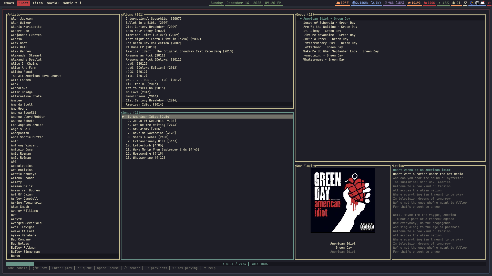

# sonic-tui

A terminal-based music player for OpenSubsonic and Navidrome servers, inspired by [jellyfin-tui](https://github.com/dhonus/jellyfin-tui).



## Table of Contents

- [Features](#features)
- [Changelog](#changelog)
- [Requirements](#requirements)
- [Installation](#installation)
- [Configuration](#configuration)
  - [Discord Rich Presence](#discord-rich-presence-optional)
- [Keybindings](#keybindings)
  - [Global](#global)
  - [Navigation](#navigation)
  - [Queue](#queue)
  - [Now Playing View](#now-playing-view)
  - [Playlists](#playlists)
  - [Search](#search)
- [Dependencies](#dependencies)
- [Troubleshooting](#troubleshooting)
- [License](#license)
- [Acknowledgments](#acknowledgments)

## Features

- **Multi-panel interface** - Browse artists, albums, songs, and queue simultaneously
- **Now Playing view** - Immersive fullscreen view with album art and lyrics/queue
- **Album art display** - Sixel/Kitty protocol support for inline images
- **Audio visualizer** - Real-time waveform visualization
- **Lyrics** - Synced lyrics from server with LRCLIB fallback
- **Discord Rich Presence** - Show what you're listening to on Discord
- **Queue management** - Add, remove, shuffle, reorder tracks, and save as playlist
- **Advanced playback** - Shuffle, repeat (all/one), and radio mode (similar songs)
- **Playlist support** - Browse, create, edit, and delete playlists
- **Search** - Search across artists, albums, and songs
- **Favorites** - Star/unstar and browse your favorite artists, albums, and songs
- **Playback history** - Track and replay your listening history
- **Statistics** - View top songs/albums/artists and recently added albums
- **Filtering & sorting** - Filter and sort content by multiple criteria (name, year, artist, track, duration, album count)
- **Scrobbling** - Server-side scrobbling support
- **Gapless playback** - Seamless transitions between tracks (the next track is queued in mpv and prefetched; `audio.gapless: false` turns it off)
- **Custom keybindings** - Remap keys to your preference
- **Vim-style keybindings** - Navigate with hjkl

## Changelog

### v0.3.1 (2026-02-08)

#### Features
- **Artist-level enqueue** - Press `a` on an artist to enqueue all their music at once (context-sensitive: works on artists, albums, and songs)
- **Improved sorting help** - Help screen now shows all available sort modes for each panel (Artists: A-Z/Z-A/Count, Albums: A-Z/Z-A/Year/Artist, Songs: Track/A-Z/Z-A/Artist/Album/Duration)
- **Centered help bar** - Bottom quick reference bar is now centered for better readability

#### Improvements
- **Performance optimization** - Reduced CPU usage by ~80% (changed event loop from 60 FPS to 10 FPS)
- **Optimized visualizer** - Faster calculations using simple pseudorandom instead of hash operations
- **Fixed scrobbling** - Now properly sends "now playing" status to Navidrome/Last.fm in addition to scrobble at 90% completion
- **Smooth track transitions** - Removed blocking prefetch that caused UI freezes between songs

#### Documentation
- Added `CACHING_IMPLEMENTATION_PLAN.md` - Detailed plan for implementing true background caching in the future

## Requirements

- A terminal with Sixel or Kitty image protocol support (for album art)
- mpv (libmpv) for audio playback
- An OpenSubsonic-compatible server (Navidrome, Airsonic, etc.)

## Installation

### From source

```bash
# Clone the repository
git clone https://github.com/yourusername/sonic-tui.git
cd sonic-tui

# Build and install
cargo install --path .
```

The binary will be installed to `~/.cargo/bin/sonic-tui`. Make sure `~/.cargo/bin` is in your `PATH`.

### Using cargo

```bash
cargo install sonic-tui
```

### NixOS

A `shell.nix` is provided for development:

```bash
nix-shell
cargo build --release
```

Or install directly with:

```bash
nix-shell
cargo install --path .
```

## Configuration

Create a configuration file at `~/.config/sonic-tui/config.yaml`:

```yaml
server:
  url: "https://your-navidrome-server.com"
  username: "your-username"
  password: "your-password"

audio:
  volume: 100
  max_bitrate: null  # null for original quality, or set to 320, 256, etc.
  gapless: true

ui:
  show_cover_art: true
  color_from_cover: false
  accent_color: null  # null for default, or hex color like "#ff5500"
  show_visualizer: true

cache:
  directory: "~/.cache/sonic-tui"
  enabled: true

discord:
  enabled: false
  # application_id: "YOUR_DISCORD_APPLICATION_ID"  # Get from https://discord.com/developers/applications

keybindings:
  # Customize any keybinding by changing its value
  # See config.example.yaml for all available keybindings
  quit: "q"
  help: "?"
  search: "/"
  # ... and many more
```

See `config.example.yaml` for all available configuration options and keybindings.

### Discord Rich Presence (Optional)

To show what you're listening to on Discord:

1. Go to https://discord.com/developers/applications
2. Click "New Application" and name it (e.g., "Music Player")
3. Copy the Application ID from the General Information page
4. Add it to your config file:
   ```yaml
   discord:
     enabled: true
     application_id: "1234567890123456789"
   ```
5. (Optional) Upload an image called "music" under Rich Presence → Art Assets for a custom icon

## Keybindings

**Note:** All keybindings can be customized in `config.yaml` under the `keybindings` section. The keys listed below are the defaults.

### Global

| Key | Action |
|-----|--------|
| `q` | Quit |
| `?` | Show help |
| `/` | Search |
| `\` | Filter current panel |
| `o` | Cycle sort mode |
| `P` | Playlists |
| `F` | Favorites |
| `H` | Playback history |
| `I` | Statistics & insights |
| `f` | Now Playing view |
| `Space` | Play/Pause |
| `n` | Next track |
| `p` | Previous track |
| `s` | Toggle shuffle |
| `r` | Cycle repeat mode (off → all → one) |
| `R` | Toggle radio mode (similar songs) |
| `+` / `=` | Volume up |
| `-` | Volume down |
| `Left` / `Right` | Seek backward/forward 5s |
| `S` | Star/unstar current item |

### Navigation

| Key | Action |
|-----|--------|
| `h` / `Left` | Focus left panel |
| `l` / `Right` | Focus right panel |
| `j` / `Down` | Move down in list |
| `k` / `Up` | Move up in list |
| `Tab` | Cycle focus between panels |
| `Enter` | Select / Play |
| `g` | Go to top of list |
| `G` | Go to bottom of list |

### Queue

| Key | Action |
|-----|--------|
| `e` | Add to queue |
| `E` | Add to queue (play next) |
| `a` | Add artist/album to queue (context-sensitive) |
| `A` | Add song to playlist |
| `d` | Remove from queue (when focused on queue) |
| `x` | Clear queue (when focused on queue) |
| `J` / `K` | Move item down/up (when focused on queue) |
| `w` | Save queue as playlist (when focused on queue) |

### Now Playing View

| Key | Action |
|-----|--------|
| `Tab` / `t` | Toggle lyrics/queue |
| `Esc` / `f` / `q` | Exit to main view |
| `j` / `k` | Navigate queue (when queue is shown) |
| `Enter` | Play selected song from queue |
| `Space` / `n` / `p` / `←` / `→` | Playback controls still work |

### Playlists

| Key | Action |
|-----|--------|
| `Enter` | Play playlist |
| `e` | Enqueue playlist |
| `d` | Delete playlist |
| `n` | Create new playlist (when adding song) |

### Search

| Key | Action |
|-----|--------|
| `Tab` | Cycle between Artists/Albums/Songs |
| `Enter` | Select result |
| `Esc` | Close search |

## Dependencies

### Runtime

- mpv (for audio playback)
- A Sixel-capable terminal (optional, for album art):
  - kitty
  - WezTerm
  - foot
  - mlterm
  - xterm (with Sixel support enabled)

### Build

- Rust 1.70+
- pkg-config
- OpenSSL development headers
- mpv development headers

#### Debian/Ubuntu

```bash
sudo apt install pkg-config libssl-dev libmpv-dev
```

#### Fedora

```bash
sudo dnf install pkg-config openssl-devel mpv-libs-devel
```

#### Arch Linux

```bash
sudo pacman -S pkg-config openssl mpv
```

#### macOS

```bash
brew install pkg-config openssl mpv
```

## Troubleshooting

### No album art showing

Make sure your terminal supports the Sixel or Kitty image protocol. You can test with:

```bash
# For Sixel
img2sixel /path/to/image.png

# For Kitty
kitty +kitten icat /path/to/image.png
```

If the art shows up as boxes or garbage, protocol detection picked one your terminal can't draw (for example
Konsole inside tmux answers the Kitty query but can't render Kitty's unicode placeholders). Force a protocol with
`ui.image_protocol` in the config, or per terminal with the `SONIC_TUI_IMAGE_PROTOCOL` environment variable:

```bash
SONIC_TUI_IMAGE_PROTOCOL=sixel sonic-tui
```

### Audio not playing

Ensure mpv is installed and working:

```bash
mpv --version
mpv /path/to/audio/file.mp3
```

### Connection errors

Verify your server URL includes the protocol (http:// or https://) and check your credentials.

## License

GPL-3.0

## Acknowledgments

- [jellyfin-tui](https://github.com/dhonus/jellyfin-tui) - Inspiration and reference
- [ratatui](https://github.com/ratatui-org/ratatui) - Terminal UI framework
- [libmpv](https://mpv.io/) - Audio playback
